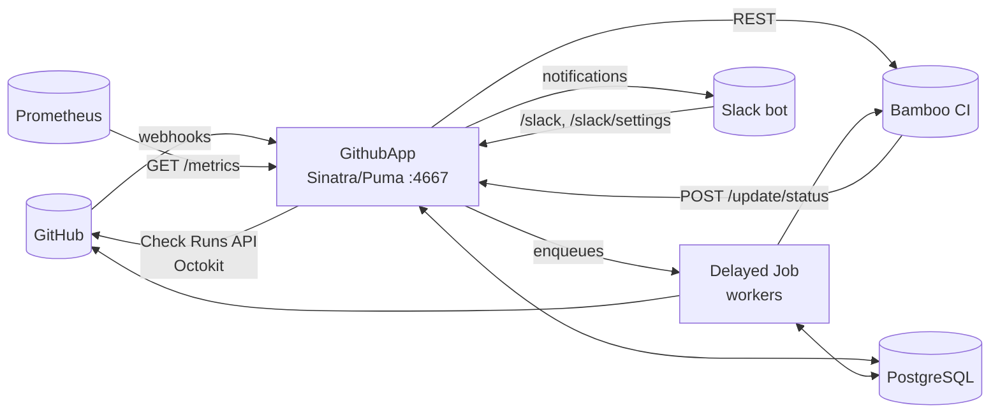

# 01 — Overview

## What the system does

`netdef-ci-github-app` is a Ruby/Sinatra webhook server that connects **GitHub Pull Requests** to an
**Atlassian Bamboo** CI server:

1. It receives GitHub events (PR opened/updated, `ci:rerun` / `ci:retry` comments, re-run requests from the Checks UI).
2. It triggers one Bamboo plan for each plan configured for the repository.
3. It creates GitHub **Check Runs** — one per *stage* and one per *job* — and keeps them up to date.
4. It receives Bamboo callbacks (`POST /update/status`) and also reconciles state in the background
   (WatchDog, TimeoutExecution) so checks never stay stuck.
5. It notifies users on Slack (execution started/finished, failures, invalid rerun) and exposes Prometheus metrics.



## Stack

| Layer | Technology |
|-------|-----------|
| Language / web | Ruby 3.1+, Sinatra, Rack, Puma |
| Database | PostgreSQL via `otr-activerecord` (ActiveRecord **without** Rails) |
| Background jobs | Delayed Job (ActiveRecord backend) — plain Ruby classes, no ActiveJob |
| GitHub | Octokit + JWT (GitHub App) |
| Tests | RSpec, FactoryBot, Faker, WebMock, DatabaseCleaner, SimpleCov (≥ 90% branch coverage) |
| Lint | Rubocop 1.56 (enforced in CI) |
| Observability | `prometheus-client`, per-component log files in `logs/` |

> The root `README.md` still mentions Sidekiq/Redis; the current code uses **Delayed Job**
> (`config/delayed_job.rb`, `delayed_jobs` table). `config/sidekiq.*` is legacy.

## Repository layout

```
app/github_app.rb      Sinatra routes (only routes, authenticates and delegates)
config.ru              Starts Puma + 3 `rake jobs:work` processes (queues 0-3, 4-6, 7-9)
config/                setup.rb (boot), delayed_job.rb, database.yml, puma.rb
database_loader.rb     ActiveRecord connection + model requires
lib/
  bamboo_ci/           Bamboo REST client (Api, PlanRun, RunningPlan, StopPlan, Retry, Result, Download)
  github/              Webhook handlers and Check API wrapper
    build_plan.rb      Entry point for the pull_request event
    build/             Action, PlanRun, Retry, Summary (+MessageFormatter), SkipOldTests, UnavailableJobs
    retry/             `ci:retry` (comment) and check_run re-request → Base/Command/Comment
    re_run/            `ci:rerun` and check_suite re-request → Base/Command/Comment
    plan_execution/    Finished (final reconciliation with Bamboo)
    topotest_failures/ Failure log parser
    check.rb           Github::Check — GitHub App auth + Check Runs/comments
    update_status.rb   Job status callback coming from Bamboo
    user_info.rb       Creates/updates GithubUser (+ Organization)
  models/              12 ActiveRecord models
  helpers/             Configuration, GithubLogger, Request (HTTP), Sinatra::Payload (auth), Prometheus*, Telemetry
  slack/ slack_bot/    Slack slash commands and notifications
workers/               Delayed Job classes (`.delay(...).method`) + standalone scripts (watch_dog, syncs)
db/migrate/            Numbered migrations (schema.rb is generated)
spec/                  app/ (Rack::Test), lib/ (mirrors lib/), workers/, factories/, support/
bin/                   console, watch_dog_{dev,prod}.sh, pr_bamboo_sync.sh
```

## Domain concepts

| Concept | Model | Meaning |
|---------|-------|---------|
| Pull Request | `PullRequest` | A GitHub PR (`github_pr_id` + `repository`). Has N `Plan`s. |
| Plan | `Plan` | A Bamboo plan (`bamboo_ci_plan_name`) tied to a repository (`github_repo_name`). |
| Check Suite | `CheckSuite` | **One CI execution** for a commit (`commit_sha_ref`) of a PR/plan. Stores `bamboo_ci_ref` (e.g. `PROJ-PLAN-42`). A new commit or rerun creates a new suite. |
| Stage | `Stage` | A plan stage (e.g. Build → Tests → …) mapped to a GitHub Check Run. Configured by `StageConfiguration` (`position`, `mandatory`, `can_retry`, `start_in_progress`). |
| CI Job | `CiJob` | A Bamboo job inside a stage (`job_ref`); also becomes a Check Run (`check_ref`). |
| Audit | `AuditStatus`, `AuditRetry` | History of status transitions (polymorphic) and of who requested a retry/rerun. |
| Topotest failure | `TopotestFailure` | Individual test failures extracted from a job. |
| Users | `GithubUser`, `Organization`, `PullRequestSubscription` | Author data, Slack link and notification subscriptions. |

### Status (enum shared by `CiJob`, `Stage`, `AuditStatus`)

`queued: 0`, `in_progress: 1`, `success: 2`, `cancelled: -1`, `failure: -2`, `skipped: -3`
(`AuditStatus` also has `refresh: 3`). State machine details in [`doc/ci/ci.md`](../ci/ci.md).

### Retry vs. Rerun

| | Trigger | Effect |
|-|---------|--------|
| **Retry** (`Github::Retry::*`) | `ci:retry` comment or the "Re-run" button of a *check_run* | Re-queues only the jobs that did not pass in the **same** suite (`BambooCi::Retry.restart`), `retry += 1`. Refused while the suite is still running. |
| **Rerun** (`Github::ReRun::*`) | `ci:rerun` comment or a *check_suite* re-request | Stops the previous execution and creates a **new** suite/full execution in Bamboo. |

### Delayed Job queues

- Numeric queues `0..9`: `UpdateStatus` uses `github_pr_id % 10` (serializes updates per PR).
- Named queues used in the code: `create_execution_by_plan`, `create_execution_by_comment`,
  `create_execution_by_command`, `timeout_execution`, `fetch_topotest_failures`.
- `config.ru` starts three processes consuming `QUEUES=0,1,2,3`, `4,5,6` and `7,8,9`.

> ⚠️ **Check before touching queues:** the processes started in `config.ru` only list numeric queues.
> If the named queues above have no other consumer (e.g. an extra worker in production),
> their jobs will not be processed. Confirm the deployment configuration before adding new queues.
