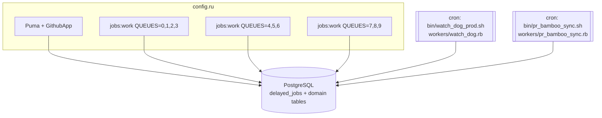

# 02 — Environment and operations

## Local setup

Prerequisites: Ruby 3.1.2+, PostgreSQL, Git, `libpq-dev`. Redis is not needed. The root [README](../../README.md) has the full installation steps.

```bash
bundle install
cp config_template.yml config.yml              # fill in (not committed)
cp database_template.yml config/database.yml   # adjust credentials if needed
RACK_ENV=development bundle exec rake db:create db:migrate
bundle exec rackup -o 0.0.0.0 -p 4667 config.ru
```

`config.ru` starts Puma **and** three Delayed Job workers (`rake jobs:work`). In `development` the
workers inherit `RACK_ENV`. There is also `deployment/server.sh` (production: migrate + rackup) and
`deployment/github_server.service` (systemd).

## Configuration (`config.yml`)

Read through `GitHubApp::Configuration.instance` (`lib/helpers/configuration.rb`); call `reload` to re-read the YAML.
Never hardcode URLs, credentials or repository names.

| Key | Use |
|-----|-----|
| `debug` | DEBUG log level in the routes |
| `port` | Server port |
| `auth_signature.password` | HMAC (SHA-256) secret for GitHub webhooks and the Bamboo callback |
| `github_apps[]` (`login`, `cert`, `repo`) | Per-GitHub-App/repository JWT credentials (used by `Github::Check`) |
| `metrics_auth` (`username`, `password`) | Basic Auth for `/metrics` |
| `slack_bot_url` | Target of Slack notifications |
| `redis` | Legacy, unused |

Slack bot (`slack_bot.netdef.org`) and Bamboo credentials come from `~/.netrc`.

## Endpoints (`app/github_app.rb`)

| Method and route | Authentication | Handler |
|------------------|----------------|---------|
| `POST /*` (event in `X-GitHub-Event`) | HMAC `X-Hub-Signature-256` | `ping`; `pull_request` → `Github::BuildPlan`; `check_run` → `Retry::Command`; `issue_comment` → `Retry::Comment` / `ReRun::Comment`; `check_suite` → `ReRun::Command`; `installation` |
| `POST /update/status` | HMAC | `Github::UpdateStatus` or, when `status == 'finished'`, `Github::PlanExecution::Finished` |
| `POST /slack`, `POST /slack/settings` | Basic (netrc) | `Slack::Running` / `Slack::Subscribe` / `Slack::Settings` |
| `GET /metrics` | Basic (`metrics_auth`) | Prometheus exporter |
| `GET /telemetry`, `GET /ping` | — | Statistics / health check |

Rule: routes only authenticate and **delegate** — no business logic and no slow external calls
(enqueue a worker instead).

## Running processes



| Worker / script | Type | Purpose |
|-----------------|------|---------|
| `CreateExecutionByPlan/Comment/Command` | Delayed Job | Creates the `CheckSuite`, cancels the previous execution, triggers the Bamboo plan and creates the checks |
| `CiJobStatus` | Delayed Job (30 s debounce) | Updates stage summaries after a job change and checks whether the execution finished |
| `CiJobFetchTopotestFailures` | Delayed Job | Fetches failures from the logs (up to 4 attempts, +5 min each) |
| `TimeoutExecution` | Delayed Job (every 30 min) | If the suite has not changed for > 2 h, calls `Finished` with `hanged: true` |
| `WatchDog` | Script (cron) | Reconciles every suite with `queued/in_progress` stages through `Finished` |
| `PrBambooSync` | Script (cron) | Report: compares active GitHub checks against Bamboo state (24 h–2 h window). **Known bug**: `process_pr` reads `pr` instead of its `pr_object` argument, so it raises `NameError` |
| `SingleSync` | Manual script | `ruby workers/single_sync.rb PROJ-PLAN-123` — resyncs one suite. **Currently broken**: it requires `workers/base.rb`, which does not exist |
| `SlackUsername2Id` | Delayed Job | Resolves the `slack_id` of a `GithubUser` |

Delayed Job (`config/delayed_job.rb`): `max_attempts = 5`, `max_run_time = 5 min`, `sleep_delay = 5 s`,
`destroy_failed_jobs = true`.

## Logs

`GithubLogger.instance.create('file.log', level)` writes to `logs/` (2 rotated files).
Main ones: `github_app.log`, `github_update_status.log`, `github_build_summary.log`,
`github_plan_execution_finished.log`, `ci_job_status.log`, `timeout_execution_worker.log`,
`delayed_job.log` and **`pr<N>.log`** (one per Pull Request — start there when debugging a PR).

## Metrics

`/metrics` exposes counters/histograms defined in `lib/helpers/prometheus_metrics/`
(HTTP requests, webhook events, exceptions, job durations, retries, timeouts, Bamboo calls via
`PrometheusMetrics.track_bamboo`, Delayed Job gauges refreshed on every scrape).
A dashboard is available in `grafana_dashboard.json`. Check whether a suitable metric already exists before creating one.

## Tests and quality

```bash
bundle exec rspec                 # --format=documentation --order=random; SimpleCov ≥ 90% branch
bundle exec rubocop               # zero offenses (use -A to autocorrect)
rake db:migrate:reset             # validates migrations from scratch
```

- Specs mirror the source path (`lib/github/build_plan.rb` → `spec/lib/github/build_plan_spec.rb`).
- Every external HTTP call must be stubbed with WebMock (`spec/support/webmock.rb`).
- Factories live in `spec/factories/` (use *traits* for variations).
- Debug console: `bin/console` (see [`doc/general/console.md`](../general/console.md)).
