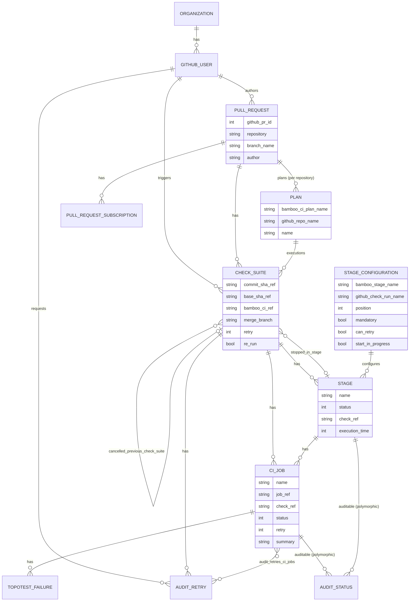
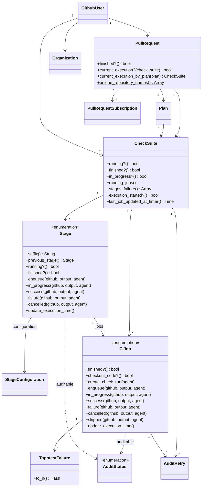
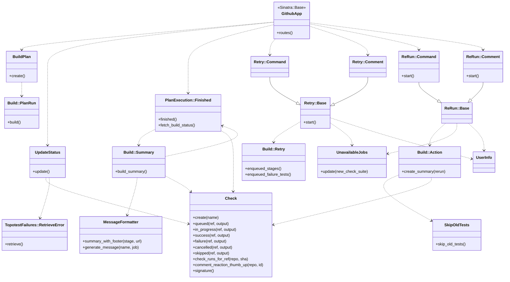
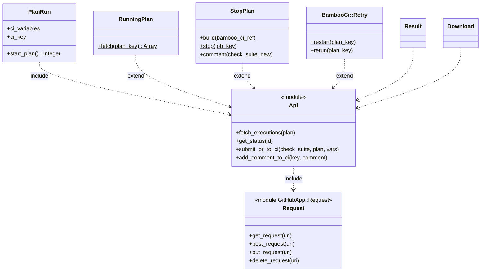

# 03 — Class diagrams

## 1. Data model (ER)

Based on `db/schema.rb` and the associations in `lib/models/`.

> `Plan` has `pull_request_id`/`check_suite_id` foreign keys, but the PR ↔ Plan link is rebuilt on every
> event from `github_repo_name` (`Github::BuildPlan#add_plans`).

## 2. Models (ActiveRecord)

The transition methods (`in_progress`, `success`, `failure`, `cancelled`, `skipped`, `enqueue`) on
`CiJob` and `Stage` do three things: update the GitHub Check Run (through `Github::Check`),
record an `AuditStatus`, and update the local `status`.

## 3. GitHub / orchestration layer

## 4. Bamboo client

Every call goes through `PrometheusMetrics.track_bamboo(...)`.

## 5. Workers, Slack and helpers

```mermaid
classDiagram
    class CreateExecutionByPlan {
        +create(pr_id, payload, plan_id)$
    }
    class CreateExecutionByComment {
        +create(pr_id, payload, plan)$
    }
    class CreateExecutionByCommand {
        +create(plan_id, check_suite_id, payload)$
    }
    class CiJobStatus {
        +update(bamboo_ci_ref, ci_job_id)$
    }
    class CiJobFetchTopotestFailures {
        +update(ci_job_id, count)$
    }
    class TimeoutExecution {
        +timeout(check_suite_id)$
        +watchdog(check_suite)$
    }
    class WatchDog {
        +perform()
    }
    class PrBambooSync {
        +perform()
    }
    class SlackUsername2Id {
        +fetch_id(username, slack_name)$
    }
    class SlackBot {
        <<Singleton>>
        +execution_started_notification(suite)
        +execution_finished_notification(suite)
        +stage_finished_notification(stage)
        +notify_errors(job)
        +notify_success(job)
        +notify_cancelled(job)
        +invalid_rerun_group(stage)
        +invalid_rerun_dm(stage, sub)
    }
    class Slack_Running["Slack::Running"]
    class Slack_Subscribe["Slack::Subscribe"]
    class Slack_Settings["Slack::Settings"]
    class Configuration {
        <<Singleton GitHubApp::Configuration>>
        +reload()
        +debug?()
        +multi_plan?()
        +ci_url()
    }
    class GithubLogger {
        <<Singleton>>
        +create(name, level)
    }
    class PrometheusMetrics {
        <<module>>
        +refresh!()
        +track_bamboo(name)
    }
    class Telemetry {
        <<Singleton>>
        +stats()
    }
    class ReRun_Base2["Github::ReRun::Base"]
    class Summary2["Build::Summary"]
    class Finished2["PlanExecution::Finished"]

    CreateExecutionByComment --|> ReRun_Base2
    CreateExecutionByCommand --|> ReRun_Base2
    CiJobStatus ..> Summary2
    CiJobStatus ..> Finished2
    TimeoutExecution ..> Finished2
    WatchDog ..> Finished2
    CiJobFetchTopotestFailures ..> TopotestFailure
    SlackUsername2Id ..> SlackBot
    Finished2 ..> SlackBot
    Slack_Subscribe ..> PullRequestSubscription
```

> `CreateExecutionByComment` and `CreateExecutionByCommand` inherit from `Github::ReRun::Base`
> (they cancel the previous execution and start a new suite); `CreateExecutionByPlan` is standalone
> (new/updated PR flow) and duplicates part of that logic.
