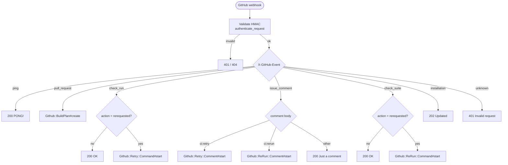
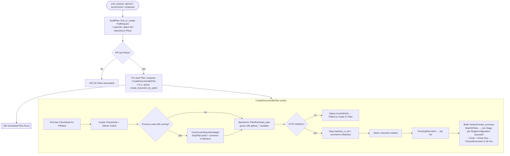
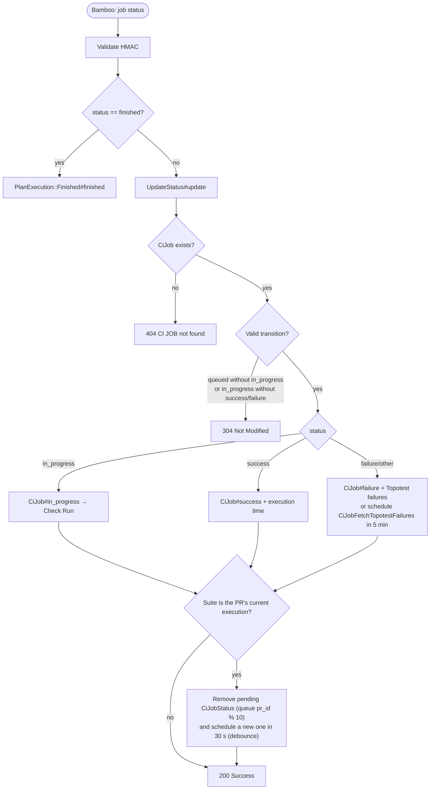
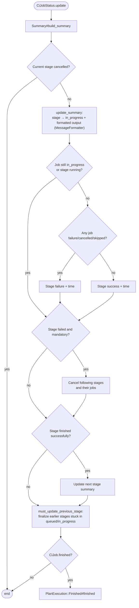
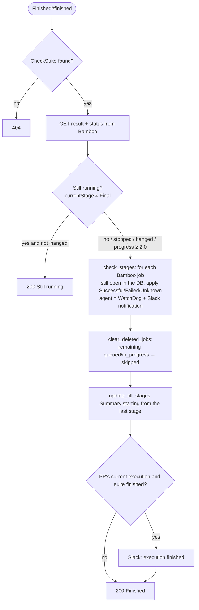
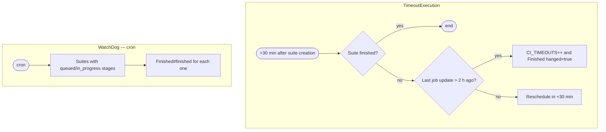
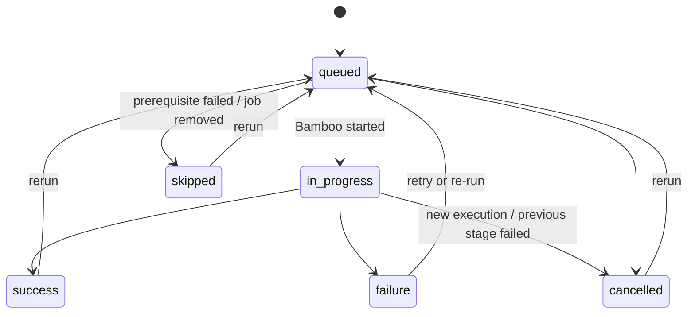
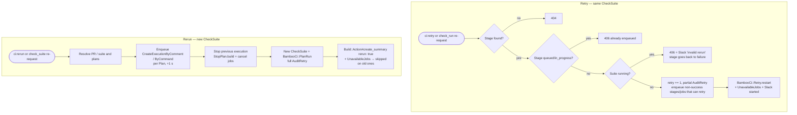
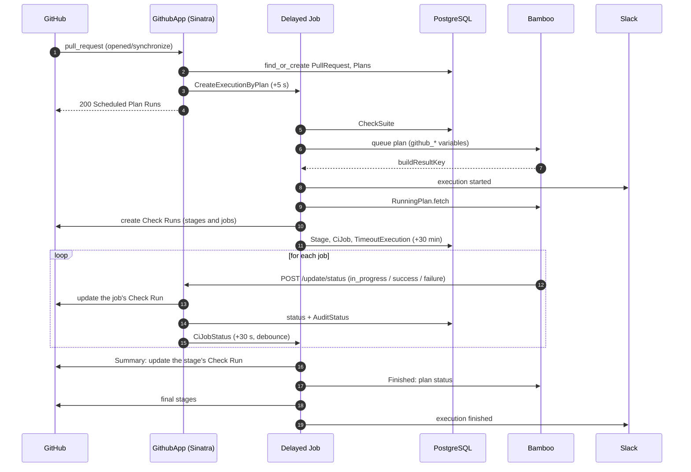

# 04 — Flowcharts and sequences

## 1. Webhook routing (`POST /*`)

## 2. PR opened / updated → Bamboo execution

## 3. Bamboo status callback (`POST /update/status`)

The *debounce* avoids recomputing the stage summary for every job: only the last callback within 30 s runs
`CiJobStatus.update`.

## 4. Stage summary update (`Build::Summary#build_summary`)

## 5. End-of-execution reconciliation (`PlanExecution::Finished`)

Called by `CiJobStatus`, the `finished` callback, `WatchDog` and `TimeoutExecution`.

## 6. Timeout and WatchDog

## 7. Stage / CiJob state machine

(Summary — full version in [`doc/ci/ci.md`](../ci/ci.md).)

## 8. `ci:retry` vs. `ci:rerun`

## 9. Full sequence — a PR's happy path

